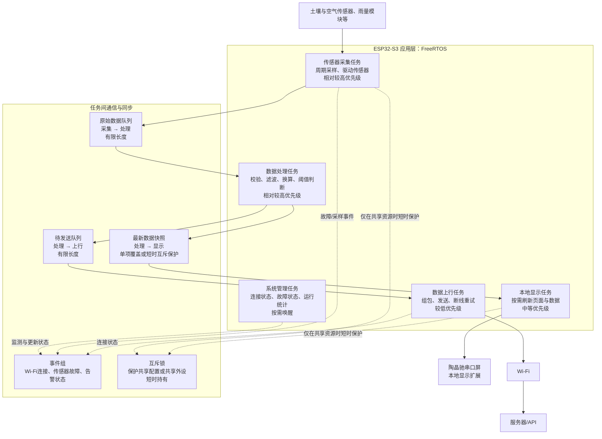

# Plant_Net FreeRTOS 任务调度架构

> 初版设计：突出传感器采集、数据处理、本地显示和数据上行之间的任务分工。具体周期、栈大小和优先级数值应在传感器型号与通信协议确定后，通过实测调整。

## 调度与数据流说明

- **采集任务**按设定周期读取传感器，把带时间戳和状态标记的数据送入有限长度的原始数据队列。它不等待屏幕刷新或网络发送。
- **处理任务**从队列取样，执行数据校验、滤波、单位换算和阈值判断，再分别更新最新数据快照、投递待发送队列，并发布故障或告警状态。
- **显示任务**按较低刷新频率读取最新快照并更新串口屏。显示侧只需展示当前状态，通常不需要逐条消费全部采样历史。
- **上行任务**独立处理 Wi-Fi 连接、数据组包和发送。网络断开时按重试策略处理；待发送队列应有容量上限，满队列时记录溢出并按数据时效选择丢弃策略，避免反向阻塞采集。
- **系统管理任务**汇总连接、传感器故障和队列溢出等运行状态，便于串口日志或后续告警功能使用。

## 调度原则

FreeRTOS 会让当前已就绪任务中优先级最高的任务先运行。采集与处理任务的相对优先级应保障数据及时进入处理链路；显示和网络任务可以较低优先级运行，并使用阻塞等待、周期延时或事件通知释放 CPU。实际优先级与周期需要结合传感器转换时间、串口波特率、网络耗时和系统负载测量后确定。

队列用于传递数据，事件组用于通知状态变化；互斥锁只用于确有共享资源的短临界区。不要在持锁期间执行串口发送、网络请求或长时间等待。
